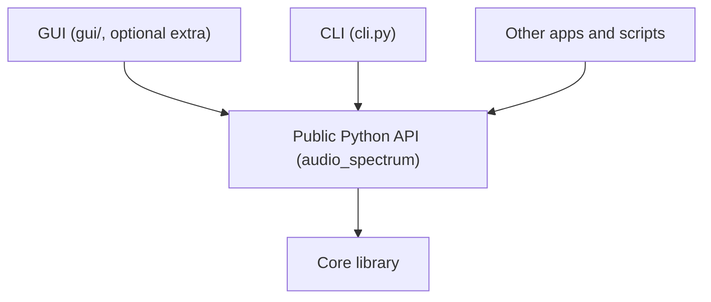
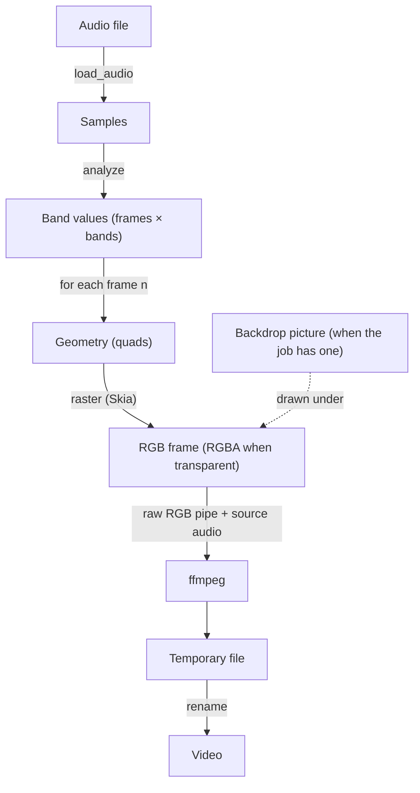

English | [日本語](../ja/ARCHITECTURE.md) | [Español](../es/ARCHITECTURE.md) · [Docs index](README.md)

# Architecture

How the renderer is built, the rules every change must keep, and where new features plug in. It is for anyone who
changes the code. Design decisions and their reasons are in the [decision log](../working/DECISIONS.md).

## 1. Layers

The CLI, the GUI and other apps all go through one public Python API, which sits on the core library.

- **Core library.** Analysis, rendering and encoding. No UI code and no UI dependencies.
- **CLI.** A thin layer that parses arguments, calls the core, and reports progress, errors and exit codes. It is the
  stable contract for tools in other languages.
- **GUI.** A local web UI on the same API, in the `audio_spectrum.gui` subpackage.
  - Its dependencies (FastAPI, uvicorn) are in the optional `gui` extra ([Requirements](../working/REQUIREMENTS.md)
    F14, ADR-008).
  - It imports only the public API, listens on `127.0.0.1` only, and requires a per-session token.
  - Importing the core never imports it.

## 2. Data flow

Audio becomes band values once; then each frame `n` is drawn from its values and streamed to ffmpeg.

| Module | Role |
|---|---|
| `audio.py` | Decodes audio with libsndfile, or ffmpeg for other formats. Selects or mixes channels |
| `analysis.py` | One spectrum per frame time `n / fps`: a window centered on that time, FFT, frequency bands, dB scale, tilt, attack/release smoothing. The FFT can be a longer one for low bands, level-matched and cross-faded |
| `presets.py` | Preset schema (pydantic) and its JSON schema. Loads built-in, user and other TOML files; manages the user preset folder; writes presets as TOML; applies overrides; gives keying warnings |
| `builtin_presets/` | The built-in presets as TOML files |
| `geometry.py` | Turns one frame of band values into quads in pixel coordinates, per look (flat, perspective) and style (bars, blocks). Places fill gradients |
| `raster.py` | Fills quads with anti-aliasing (Skia) into an RGB frame, in a solid color or a linear gradient. With a transparent background, the frame is RGBA with straight alpha |
| `renderer.py` | Combines geometry and raster for one frame, over the preset's background color or a supplied picture |
| `encode.py` | Builds the ffmpeg command. `VideoWriter` streams frames, writes to a temporary file and renames it on success. `write_png` writes stills the same way. For part of a song, the audio is cut at exact samples |
| `pipeline.py` | `render_video`: load, analyze, render frames (in parallel worker processes), encode; progress and cancellation. `render_stills` and `Preview`: single frames for checks and GUIs; `Preview` keeps the analysis. `Backdrop`: the picture under the spectrum supplied by an embedding app, asked for in the workers per frame |
| `errors.py` | Error types with stable codes |
| `cli.py` | Commands, progress output, exit codes, signal handling |
| `gui/` | `app.py`: HTTP API and page, with the host and token checks. `dialogs.py`: native macOS file dialogs. `server.py`: start-up. `static/`: the page (`index.html`, `app.js`, `app.css`, no build step) and its texts in `i18n/` (`en`, `ja`, `es`) |

## 3. Invariants

Every change must keep these:

1. **Exact sync.** Frame `n` shows the audio at time `n / fps`. The number of frames is `ceil(samples × fps / rate)`.
   Rendering never depends on real-time playback or on machine speed. Tested with click tracks in
   `tests/test_video.py`.
2. **Determinism.** The same input, preset and options give the same frames, in one process or many.
3. **No partial outputs.** A file with the final output name is always complete. Failures, cancellation and
   interruptions leave no output or temporary file.
4. **The core has no UI code.** The CLI and the GUI only call the public API and add no rendering logic.
5. **Presets describe the look only.** Output settings (size, frame rate, codec) stay outside presets.
6. **Repository safety.** No songs, rendered videos or personal data in the repository; tests use generated signals.

## 4. Performance

A 4-minute song renders in about 2 minutes at 1080p30 on an M1; with parallel workers the H.264 encoder is the limit.

- Analysis of a whole song takes well under a second.
- Drawing takes about 13 ms per 1080p frame on one core.
- `render_video` draws frames in worker processes (CPU cores minus one by default).
- Workers run at most a few chunks ahead of ffmpeg, so memory stays bounded.

Measurements: [Phase 0 results](../working/PHASE0_RESULTS.md).

## 5. Extension points

| To add | Where |
|---|---|
| A new look (for example circular, blocks) | A look model in `presets.py` with a new `kind`, and its quad builder in `geometry.py`. The raster backend and the rest stay unchanged |
| New analysis options | Fields in `AnalysisSettings` and their use in `analysis.py`. Give the fields defaults, so old presets keep working |
| Effects such as glow | Drawn by the raster backend together with the shapes (`raster.py`), configured in the preset's `[fx]` table (ADR-011). Effects that depend on earlier frames belong in the analysis |
| A new output format | `EncodeSettings` and `build_command` in `encode.py`, plus a `--codec` choice in `cli.py` |
| A GPU or 3D renderer | Another rasterizer or renderer behind the same `render(values) -> frame` call |
| Pictures under the spectrum from another app (backgrounds, captions) | A `Backdrop` in that app, passed as `RenderJob.backdrop`. This repository gets no lyrics or layout logic (ADR-013). A layer over the spectrum would be a separate hook |
| A GUI feature | An endpoint in `gui/app.py` calling the public API, and its controls in `gui/static/app.js`. If the API lacks something, add it there first. New preset keys appear in the forms by themselves, from `preset_schema()`; they need a label and help text in each `gui/static/i18n/*.json`. Design: ADR-012 |

When a change alters the preset format incompatibly, raise `schema_version` and keep reading version 1 files.
