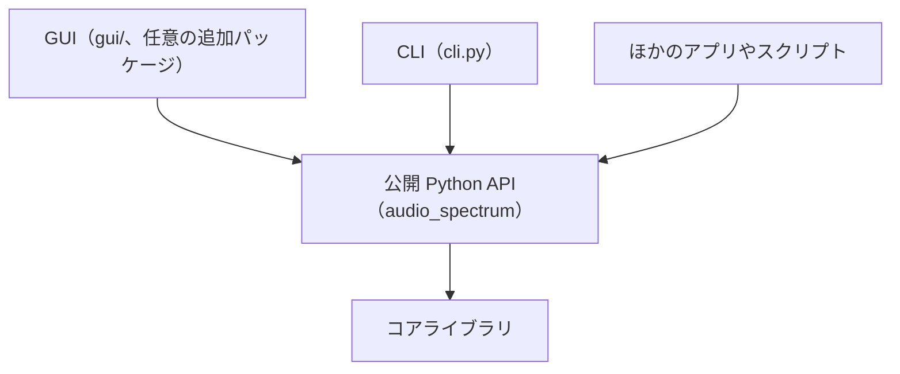
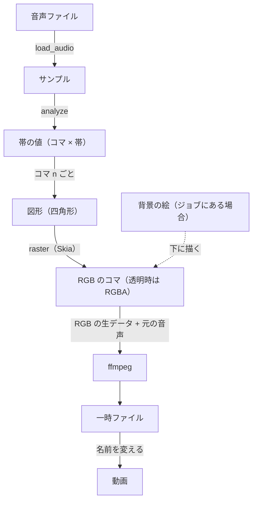

<!-- source: docs/en/ARCHITECTURE.md blob 74d3e19b59de45aa8c6ecc194607b255ab0ce7ef -->
[English](../en/ARCHITECTURE.md) | 日本語 · [目次に戻る](README.md)

> この文書は[英語版](../en/ARCHITECTURE.md)の翻訳。内容が異なる場合は英語版が優先する。

# アーキテクチャ

レンダラーの構成、どの変更でも守るルール、新しい機能を差し込む場所をまとめる。コードを変える人向け。設計判断と
その理由は[設計判断の記録](../working/DECISIONS.md)（英語のみ）にある。

## 1. 層構成

CLI も GUI もほかのアプリも、1 つの公開 Python API を通り、その下にコアライブラリがある。

- **コアライブラリ。** 解析・描画・書き出しを受け持つ。UI のコードも UI 用の依存も持たない。
- **CLI。** 引数を解釈してコアを呼び、進捗・エラー・終了コードを伝える薄い層。ほかの言語のツールに対する安定した
  約束事になる。
- **GUI。** 同じ API の上に作ったローカル Web UI で、`audio_spectrum.gui` サブパッケージにある。
  - 依存（FastAPI、uvicorn）は任意の追加パッケージ `gui` に入れる（[要件](../working/REQUIREMENTS.md) F14、
    ADR-008。いずれも英語のみ）。
  - 公開 API だけを使い、`127.0.0.1` でだけ待ち受け、セッションごとのトークンを求める。
  - コアを読み込んでも GUI は読み込まれない。

## 2. データの流れ

音声は一度だけ帯の値に変える。そのあと各コマ `n` をその値から描き、ffmpeg に流し込む。

| モジュール | 役割 |
|---|---|
| `audio.py` | libsndfile（ほかの形式は ffmpeg）で音声を読み込む。チャンネルを選ぶか混ぜる |
| `analysis.py` | コマの時刻 `n / fps` ごとにスペクトラムを 1 つ作る。その時刻を中心にした窓、FFT、周波数帯、dB 変換、傾き補正、上がり下がりの平滑化。低い帯には、より長い FFT を使える（レベルを合わせ、なめらかにつなぐ） |
| `presets.py` | プリセットの定義（pydantic）と JSON スキーマ。組み込み・ユーザー・その他の TOML ファイルを読み込み、ユーザープリセットのフォルダを扱い、プリセットを TOML に書き出し、上書きを適用し、キーイングの警告を出す |
| `builtin_presets/` | 組み込みプリセットの TOML ファイル |
| `geometry.py` | 1 コマ分の帯の値を、見た目（flat、perspective）とスタイル（bars、blocks）ごとにピクセル座標の四角形へ変える。塗りのグラデーションの位置を決める |
| `raster.py` | 四角形をアンチエイリアス付き（Skia）で、単色か線形グラデーションで RGB のコマに塗る。透明な背景では、ストレートアルファの RGBA のコマになる |
| `renderer.py` | 1 コマについて geometry と raster を組み合わせる。プリセットの背景色か、渡された絵の上に描く |
| `encode.py` | ffmpeg のコマンドを組み立てる。`VideoWriter` がコマを流し込み、一時ファイルに書いて成功時に名前を変える。`write_png` も静止画を同じ方法で書く。曲の一部だけのときは、音声をサンプル単位で正確に切る |
| `pipeline.py` | `render_video`：読み込み、解析、コマの描画（並列のワーカープロセス）、書き出し。進捗とキャンセルも扱う。`render_stills` と `Preview`：確認や GUI 用に 1 コマずつ描く。`Preview` は解析結果を持ち続ける。`Backdrop`：組み込み先のアプリが用意する、スペクトラムの下の絵。ワーカーがコマごとに求める |
| `errors.py` | 固定のコードを持つエラー型 |
| `cli.py` | コマンド、進捗の出力、終了コード、シグナルの扱い |
| `gui/` | `app.py`：HTTP の API と画面、Host とトークンの確認。`dialogs.py`：macOS 標準のファイル選択画面。`server.py`：起動。`static/`：画面（`index.html`、`app.js`、`app.css`。ビルド不要）と、`i18n/` の文言（`en`、`ja`、`es`） |

## 3. 不変条件

どの変更でも、次を守る。

1. **正確な同期。** コマ `n` は時刻 `n / fps` の音を表す。コマ数は `ceil(サンプル数 × fps / サンプリングレート)`。
   描画はリアルタイム再生にもマシンの速さにも左右されない。`tests/test_video.py` のクリック音で確かめている。
2. **決定性。** 入力・プリセット・オプションが同じなら、1 プロセスでも複数プロセスでも同じコマになる。
3. **途中のファイルを残さない。** 正式な出力名のファイルは必ず完全だ。失敗・キャンセル・中断のあとには、出力も
   一時ファイルも残らない。
4. **コアは UI のコードを持たない。** CLI と GUI は公開 API を呼ぶだけで、描画の処理を自分では持たない。
5. **プリセットは見た目だけを表す。** 出力の設定（サイズ、フレームレート、コーデック）はプリセットに入れない。
6. **リポジトリの安全。** 曲、書き出した動画、個人情報はリポジトリに入れない。テストは生成した信号を使う。

## 4. 性能

M1 では 4 分の曲を 1080p30 で約 2 分で書き出せる。並列時は H.264 エンコーダーが律速になる。

- 1 曲全体の解析は 1 秒もかからない。
- 描画は 1080p の 1 コマあたり、1 コアで約 13 ms。
- `render_video` はコマをワーカープロセス（既定は CPU コア数 − 1）で描く。
- ワーカーは ffmpeg より数チャンク先までしか進まないので、メモリ使用量は一定に収まる。

測定値は [Phase 0 の結果](../working/PHASE0_RESULTS.md)（英語のみ）にある。

## 5. 拡張ポイント

| 追加するもの | 場所 |
|---|---|
| 新しい見た目（例：円形） | `presets.py` に新しい `kind` の見た目モデル、`geometry.py` にその四角形の生成を足す。描画の下回りなどはそのまま |
| 新しい解析オプション | `AnalysisSettings` の項目と、`analysis.py` での利用。古いプリセットが動くよう、項目には既定値を付ける |
| 発光などのエフェクト | 描画の下回り（`raster.py`）が図形と一緒に描き、プリセットの `[fx]` 表で設定する（ADR-011）。前のコマに依存するエフェクトは解析側に置く |
| 新しい出力形式 | `encode.py` の `EncodeSettings` と `build_command`、`cli.py` の `--codec` の選択肢 |
| GPU や 3D のレンダラー | 同じ `render(values) -> frame` の呼び出しの裏に、別の rasterizer か renderer を置く |
| ほかのアプリからのスペクトラムの下の絵（背景、字幕） | そのアプリ側の `Backdrop` を `RenderJob.backdrop` に渡す。このリポジトリには歌詞や配置の処理を入れない（ADR-013）。スペクトラムの上の層は別の仕組みになる |
| GUI の機能 | 公開 API を呼ぶエンドポイントを `gui/app.py` に、操作部品を `gui/static/app.js` に足す。API に足りないものがあれば先に API へ足す。プリセットの新しい項目は `preset_schema()` から自動でフォームに出るが、各 `gui/static/i18n/*.json` に名前と説明が要る。設計は ADR-012 |

プリセットの形式を互換性のない形で変えるときは、`schema_version` を上げ、バージョン 1 のファイルも読めるようにしておく。
